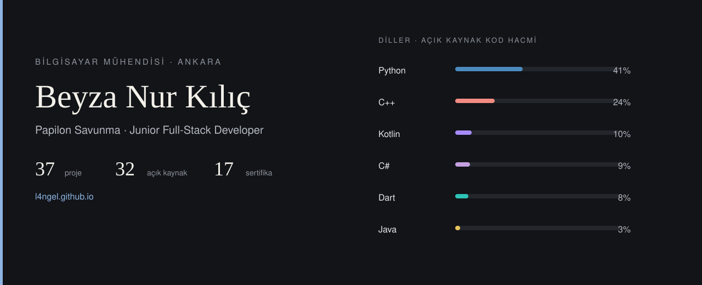

Bilgisayar mühendisiyim. Papilon Savunma'da junior full-stack developer olarak çalışıyorum.

### Seçili projeler

**Bilgisayarlı görü**
- [stereo-3d-mot](https://github.com/l4NGEL/stereo-3d-mot) — C++17 stereo derinlik, 3B çoklu nesne takibi ve görsel odometri, KITTI üzerinde değerlendirme
- [iha-takip](https://github.com/l4NGEL/iha-takip) — termal kamerada küçük İHA tespiti ve takibi, C++ TensorRT hattı
- [AutoTrack](https://github.com/l4NGEL/AutoTrack) — örtülmeye dayanıklı çoklu nesne takibi, MOT17 üzerinde hata analizi
- [polip-tespit](https://github.com/l4NGEL/polip-tespit) — kolonoskopi polip segmentasyonu, başka merkezin verisiyle dış test

**Gömülü ve aviyonik**
- [yer-istasyonu-qt](https://github.com/l4NGEL/yer-istasyonu-qt) — Qt 6/QML MAVLink yer kontrol istasyonu, SITL ve video
- [aviyonik-veriyolu](https://github.com/l4NGEL/aviyonik-veriyolu) — MIL-STD-1553B ve CAN/ISO-TP veri yolu kütüphanesi, FreeRTOS
- [cihaz-izleme-qt](https://github.com/l4NGEL/cihaz-izleme-qt) — UART, Modbus ve CAN üzerinden cihaz izleme ve kayıt
- [blade-fem](https://github.com/l4NGEL/blade-fem) — türbin kanadı kesitlerinde sonlu eleman termal gerilme analizi

**Yapay zekâ ve veri**
- [belge-rag](https://github.com/l4NGEL/belge-rag) — kaynak gösteren belge soru-cevap servisi, .NET 8 ve pgvector
- [teknikyaz-asistan](https://github.com/l4NGEL/teknikyaz-asistan) — Türkçe teknik dokümantasyon asistanı, hibrit RAG ve çok ajanlı akış
- [nabiz](https://github.com/l4NGEL/nabiz) — titreşim ve akustikle anomali tespiti, kalan ömür tahmini, ONNX
- [sql-saldiri-tespit](https://github.com/l4NGEL/sql-saldiri-tespit) — 16 milyon ağ akışında SQL tabanlı öznitelik çıkarma ve saldırı tespiti

**Uygulama ve servis**
- [GeoCommand](https://github.com/l4NGEL/GeoCommand) — harita tabanlı görev ve olay takibi, WPF, SignalR, PostGIS
- [abone-provisioning](https://github.com/l4NGEL/abone-provisioning) — Spring Boot ve Oracle PL/SQL ile hat provisioning servisi
- [fis-cuzdan](https://github.com/l4NGEL/fis-cuzdan) — cihaz üstü OCR ile fiş ve harcama takibi, Kotlin/Compose

Tüm çalışmalar: [l4ngel.github.io](https://l4ngel.github.io/)

[byznrklc01@gmail.com](mailto:byznrklc01@gmail.com) · [LinkedIn](https://www.linkedin.com/in/beyza-nur-kili%C3%A7/)
